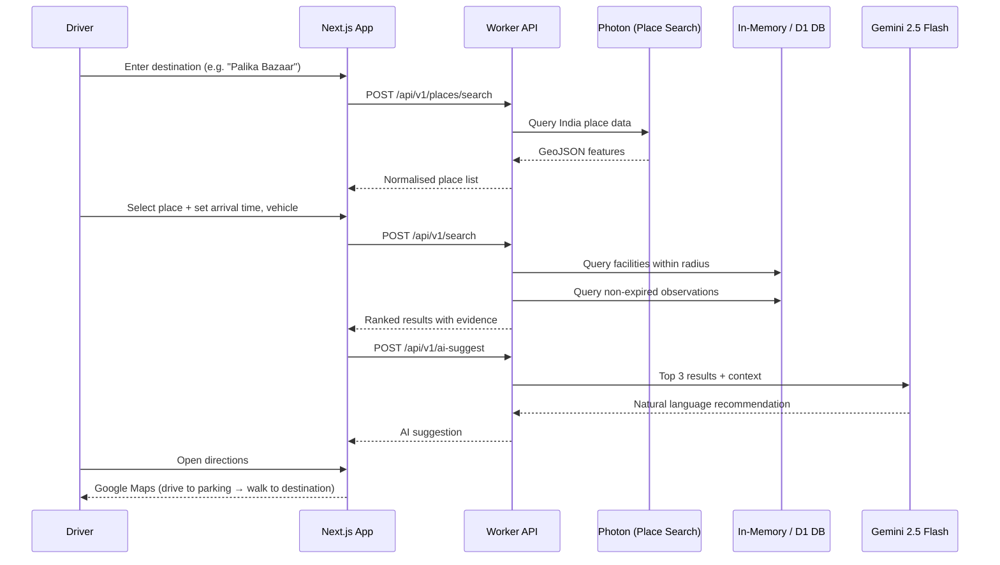

<div align="center">


# ParkMyCar

**The parking decision tool built for Indian drivers.**  
Search any destination in India. Compare real nearby parking. Get directions.

[](https://parkmycarr.netlify.app)
[](https://parkmycarr.netlify.app)
[](LICENSE)
[](LICENSE)
[](https://nextjs.org/)
[](https://www.typescriptlang.org/)
[](https://tailwindcss.com/)
[](https://leafletjs.com/)
[](https://ai.google.dev/)

**[Try it live →](https://parkmycarr.netlify.app)**  |  [How it works](#how-it-works)  |  [What's different](#what-makes-this-different)  |  [Deploy your own](#deploy-your-own)  |  [API Docs](#api-reference)

</div>

---

## The problem this solves

Most drivers in India find parking by guessing. Google Maps shows parking dots — no access rules, no vehicle fit check, no honest signal of whether the place is actually open or full. Navigation apps are built for *getting there*, not for *choosing where to park once you arrive*.

**ParkMyCar is built around the single moment that matters: arriving at a destination and needing to make a real parking decision.**

Before you arrive, you need answers to three specific questions:

| Question | What apps show today | What ParkMyCar shows |
|---|---|---|
| **Can I use this parking?** | A pin. Maybe a label. | Access type (Public / Customers only / Permit / Unknown), vehicle compatibility, entry notes |
| **Which option fits my trip?** | One suggestion, if any | Up to 30 ranked options — by distance or price — with a save shortlist for alternatives |
| **How current is this?** | No indication | Evidence source, timestamp, TTL expiry. If data is stale: **"Availability not confirmed"** |

---

## What makes this different

### 1. Evidence-First Architecture — No Fake Availability

Every parking status shown has a **traceable source, a reporter, and an expiry time**. When a report expires, the state resets to `UNKNOWN` — it does not roll over as "still available."

```
STATIC_LISTING      → Mapped from OSM/NDMC. No live status.
OPERATOR_REPORTED   → Posted by a verified operator for this facility.
COMMUNITY_REPORTED  → Submitted by a driver, reviewed before publishing.
```

There is no interpolation, no guessing, no stale data dressed as fresh data. This is the core design principle.

### 2. Access Gate Differentiation — Not Just "Parking"

The app distinguishes between five access states that matter to different drivers:

```
PUBLIC           → Anyone can park
CUSTOMERS_ONLY   → Restricted to customers of the venue
PRIVATE          → Not shown in public results
PERMIT           → Not shown in public results  
UNKNOWN          → Shown with "Check access before arrival" warning
```

This is not a cosmetic filter. Private and permit-only facilities are excluded from search results. You won't navigate to a parking area that won't let you in.

### 3. Four-Step Decision Flow

```
Search destination → Filter by vehicle/type/features → Compare up to 3 → Open directions
```

The flow ends with **two sets of directions**: drive to parking, then walk to your destination. The walking leg is shown separately because it is the leg most apps ignore.

### 4. Reviewed Report Pipeline

Driver reports don't publish instantly. They enter a review queue:

```
Driver submits → Review queue → Reviewer decides → Published (or rejected)
```

Reports carry: who submitted it, when, and when it expires. The expiry is strict — a 15-minute observation cannot survive as "current" for an hour.

### 5. AI Parking Assistant (Gemini 2.5 Flash)

After each search, the app optionally surfaces a Gemini-powered natural language recommendation — a single sentence that weighs distance, availability state, hours, and price. It degrades gracefully: if no API key is configured, it simply doesn't appear.

---

## How it works



---

## Live demo

**→ [https://parkmycarr.netlify.app](https://parkmycarr.netlify.app)**

**What you can do right now:**
- Search any destination in India by name, landmark, neighbourhood, or city
- View 5 sourced parking facilities in Connaught Place, New Delhi
- Filter by vehicle type, parking type, radius, and features
- Save up to 3 options to a shortlist and compare them side by side
- Open driving directions to any parking facility
- Report an issue with a listing (enters the moderated review queue)
- View evidence source and timestamp for every status shown

**Current pilot area:** Connaught Place, New Delhi (5 verified facilities from OSM + NDMC)  
**Place search:** All of India (cities, towns, villages, landmarks via Photon + OSM)

---

## Deploy your own

### One-click deploy

[](https://app.netlify.com/start/deploy?repository=https://github.com/Rohi56u/PARKMYCAR)
[](https://vercel.com/new/clone?repository-url=https://github.com/Rohi56u/PARKMYCAR)

### Manual deploy

```bash
git clone https://github.com/Rohi56u/PARKMYCAR.git
cd PARKMYCAR
pnpm install
pnpm dev
```

Requirements: **Node.js ≥ 22.13**, **pnpm 11**

### Enable AI suggestions (optional)

Get a free API key at [aistudio.google.com](https://aistudio.google.com) and set it as an environment variable:

```
GEMINI_API_KEY=your_key_here
```

On Netlify: Site settings → Environment variables → Add `GEMINI_API_KEY`.  
The app works fully without this key — AI suggestions simply won't appear.

### Netlify config (already included)

```toml
# netlify.toml
[build]
  command = "pnpm run build"
  publish = ".next"

[build.environment]
  NODE_VERSION = "22"
```

---

## Project structure

```
parkmycar/
├── app/
│   ├── api/v1/
│   │   ├── [...path]/route.ts     # Main API handler (search, reports, workspace)
│   │   └── ai-suggest/route.ts    # Gemini AI recommendation endpoint
│   ├── research/page.tsx          # Evidence and sources page
│   └── workspace/page.tsx         # Operator/admin management UI
├── components/
│   ├── ParkApp.tsx                # Main client app
│   ├── ParkingMap.tsx             # Leaflet map (SSR-safe via next/dynamic)
│   ├── AiSuggest.tsx              # AI suggestion bar component
│   └── PlaceSearch.tsx            # India-wide place search
├── lib/
│   ├── domain.ts                  # Types + search engine + evidence selection
│   ├── service.ts                 # API route handlers
│   ├── store.ts                   # DB abstraction layer + rate limiting
│   ├── db.ts                      # Universal in-memory DB (no native deps)
│   ├── geocoding.ts               # Photon place search + cache
│   └── contracts.ts               # Zod schemas + API error types
├── data/
│   └── source-catalog.json        # 5 sourced CP parking facilities
└── docs/
    ├── API.md                     # Full API reference
    ├── ARCHITECTURE.md            # Technical design
    └── DATA.md                    # Data sources and licensing
```

---

## API reference

Base URL: `https://parkmycarr.netlify.app/api/v1`

| Method | Path | Description |
|--------|------|-------------|
| `GET` | `/health` | Health check — returns `{status:"ok", catalogueVersion}` |
| `GET` | `/bootstrap` | Fetch all destinations, facilities and coverage metadata |
| `POST` | `/places/search` | Search places across India (requires `Same-Origin`) |
| `POST` | `/search` | Find and rank parking near a destination |
| `GET` | `/facilities/:id` | Get a single facility with current evidence |
| `POST` | `/reports` | Submit a driver report (requires `Same-Origin`) |
| `POST` | `/ai-suggest` | Get Gemini AI parking recommendation |
| `GET` | `/workspace` | Operator/admin dashboard data (requires auth) |

### POST /search — request body

```json
{
  "destination": { "lat": 28.6313, "lng": 77.2179 },
  "origin": { "lat": 28.6100, "lng": 77.2090 },
  "radius": 1000,
  "arrivalAt": "2026-10-31T14:00:00+05:30",
  "durationMinutes": 120,
  "vehicle": "CAR",
  "requirements": [],
  "type": "all",
  "sort": "distance",
  "includeUnknown": true,
  "includeCustomer": false
}
```

### POST /search — response

```json
{
  "results": [
    {
      "id": "palika",
      "name": "Palika Parking",
      "type": "underground",
      "access": "PUBLIC",
      "distanceMeters": 142,
      "evidence": {
        "state": "UNKNOWN",
        "evidenceClass": "STATIC_LISTING",
        "label": "Mapped parking",
        "source": null,
        "observedAt": null,
        "expiresAt": null,
        "conflict": false
      },
      "hoursState": "unknown",
      "totalCost": null,
      "reasons": ["140 m from your destination", "Underground parking", "Listed by NDMC"]
    }
  ],
  "coverage": { "name": "Connaught Place, New Delhi", ... },
  "serverTime": "2026-10-31T08:30:00.000Z",
  "catalogueVersion": "cp-2026-10-17-v1"
}
```

---

## Data sources

All data is sourced, dated, and attributed. No data is invented.

| Source | What it contributes | License |
|--------|---------------------|---------|
| OpenStreetMap | Facility locations, type, mapped access | ODbL 1.0 |
| NDMC (ndmc.gov.in) | Municipal facility confirmation for Connaught Place | Public record |
| BMRCL (2026 Metro Parking Policy) | Policy evidence for urban parking demand | Public record |
| MoHUA Lok Sabha Q292 (Mar 2026) | Infrastructure context | Public record |
| Photon (komoot.io) | Place search geocoding across India | ODbL 1.0 |

Data currency and source links are visible within the app on every facility listing.

---

## Roadmap

The expansion plan follows a phased release gate model — each stage requires meeting reliability criteria before proceeding:

```
01  CURRENT    Working app · India place search · 5 sourced CP facilities · AI suggestions
02  NEXT       Field pilot · Survey entrances · Confirm rules · Onboard operators
03  THEN       Live operations · Operator APIs · Gate counts · Bay sensors
04  THEN       City expansion · PostGIS spatial search · Multi-language · New areas
```

No city is added without a surveyed facility with a named source and accountable owner. This is the release gate.

---

## Roles

The app has three distinct user roles with strictly enforced permissions:

| Role | Can do |
|------|--------|
| **Driver** | Search, compare, save shortlist, report issues |
| **Operator** | Update assigned parking listings, post status observations |
| **Admin** | Review reports, moderate changes, manage team, view audit log |

Operators work only on locations assigned to them. Admins review all changes. Every write action creates an audit event.

---

## License

This project is dual-licensed:

**[MIT License](LICENSE)** — permissive use, modification, and distribution with attribution.  
**[Apache License 2.0](LICENSE)** — same permissive terms, with explicit patent grant.

You may use this project under either license.

Copyright © 2026 [Rohit Choudhary (Rohi56u)](https://github.com/Rohi56u)

---

## Acknowledgements

- [OpenStreetMap contributors](https://openstreetmap.org/copyright) — map data and facility locations
- [Photon by Komoot](https://photon.komoot.io) — geocoding API
- [Leaflet](https://leafletjs.com) — interactive maps
- [Next.js](https://nextjs.org), [Tailwind CSS](https://tailwindcss.com), [Lucide](https://lucide.dev) — UI stack
- [Google Gemini API](https://ai.google.dev) — AI suggestions (optional)
- NDMC, BMRCL, MoHUA — public data sources

---

<div align="center">

**[parkmycarr.netlify.app](https://parkmycarr.netlify.app)** · **[GitHub](https://github.com/Rohi56u/PARKMYCAR)**

*A place for your car. A plan for your journey.*

</div>
