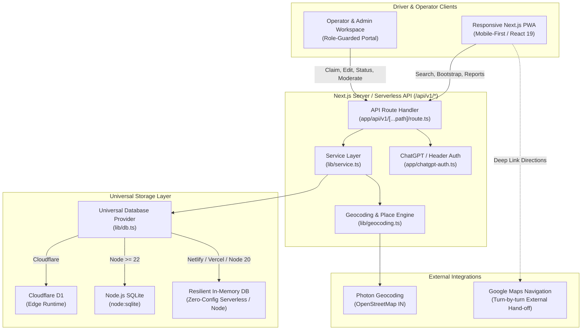

<div align="center">

# 🚗 ParkMyCar

### Destination Parking Discovery & Decision Intelligence Engine for India

[](https://app.netlify.com/start/deploy?repository=https://github.com/Rohi56u/PARKMYCAR)
[](https://vercel.com/new/clone?repository-url=https://github.com/Rohi56u/PARKMYCAR)

[](https://opensource.org/licenses/MIT)
[](https://opensource.org/licenses/Apache-2.0)
[](https://nextjs.org/)
[](https://react.dev/)
[](https://www.typescriptlang.org/)
[](https://tailwindcss.com/)
[](https://orm.drizzle.team/)
[](https://leafletjs.com/)
[](CONTRIBUTING.md)

<p align="center">
  <b>A route to your destination. Clarity to choose parking.</b><br/>
  Compare suitable parking options near your destination with driving detour, pedestrian walk distance, access gates, verified price basis, and transparent evidence freshness — with zero false certainty.
</p>

<p align="center">
  🌐 <b>Live Web App:</b> <a href="https://parkmycarr.netlify.app"><b>https://parkmycarr.netlify.app</b></a>
</p>

[Explore Features](#-key-features) •
[System Architecture](#-system-architecture) •
[Quickstart](#-quickstart-guide) •
[Deployment Guide](#-zero-config-deployment) •
[API Reference](#-api-specification) •
[Dual License](#-licensing)

</div>

---

## 📌 Overview

Most navigation apps treat parking as an afterthought: placing a static pin on a venue centroid that reveals nothing about whether the entrance is open, if your vehicle fits, or how far the physical walk is to your destination gate.

**ParkMyCar** is an arrival-first decision support layer engineered for Indian urban mobility. It pairs whole-India place search with an auditable parking directory (pioneered in Connaught Place, New Delhi) to answer the driver's real pre-arrival questions:

1. **"Can I actually enter?"** — Differentiates public lots from private, permit-only, or customer-restricted zones, with explicit height clearance and vehicle compatibility.
2. **"What is the real walk?"** — Separates vehicular route detour from the pedestrian walk from the parking gate to the destination entrance.
3. **"How fresh is this information?"** — Implements an evidence-first status engine: operator updates and community reports carry visible timestamps and strict TTL expiration. If data is missing or stale, it clearly states **`Availability not confirmed`** instead of guessing.

---

## ⚡ Key Features

| Capability | Engineering Implementation | User Benefit |
| :--- | :--- | :--- |
| 📍 **All-India Place Search** | Photon API backed by OpenStreetMap with `countrycode=IN` bounding. | Search cities, towns, villages, and landmarks across India with full state/district context. |
| 🛡️ **Evidence Integrity State Machine** | Strict decay rules: Operator updates, Driver reports, and Static records. | Zero fake "live" badges. Stale reports automatically decay to *Availability not confirmed*. |
| 🚶 **Arrival Fit & Walking Proximity** | PostGIS/Spatial bounding queries + straight-line & Google Maps navigation hand-offs. | Make informed choices based on gate proximity and pedestrian walking distance. |
| 🏷️ **Transparent Rate Cards** | Relational tariff rules with currency (`₹`), billing interval, and verification timestamps. | Know exact parking tariffs before arrival. Missing pricing is marked `Unknown`, never assumed `Free`. |
| 🗺️ **Interactive Leaflet Maps** | Client-safe, dynamic SSR-resistant Leaflet maps with custom SVG vector pins and vector fallback. | Smooth mobile-first map exploration across low-end mobile devices and high-DPI screens. |
| 🏢 **Operator & Admin Portal** | Role-based authentication (Admin, Operator, Reviewer), listing edits, and moderation queues. | Facility managers can publish official updates; crowd reports undergo review before publication. |
| 🔒 **Privacy-First Telemetry** | Ephemeral rate-limiting hashes, optional one-time GPS, no persistent trip coordinate storage. | Full search functionality without sign-up, tracking cookies, or license plate capture. |

---

## 🏗️ System Architecture

ParkMyCar is built as a **Lean Modular Monolith** that runs universally on **Node.js, Netlify, Vercel, Docker, and Cloudflare Workers**:



---

## 📊 Availability Truth Table

ParkMyCar operates under strict domain invariants to eliminate false certainty:

```
┌────────────────────────────┬─────────────────────────────┬──────────────────────────────────────────────────┐
│ Observation Source         │ UI Evidence Badge           │ Operational Semantics                            │
├────────────────────────────┼─────────────────────────────┼──────────────────────────────────────────────────┤
│ Static Directory Record    │ Mapped Parking (Neutral)    │ Base directory pin. Availability not confirmed.  │
│ Operator-Verified Update   │ Operator updated · [Time]   │ Published by assigned lot manager within TTL.   │
│ Driver Crowd Report        │ Community reported · [Age]  │ Peer report approved through moderation queue.   │
│ Stale / Expired Status     │ Availability not confirmed  │ Observation exceeded TTL (5-60 min). Reverts.    │
│ Sensor Feed / ML Predict   │ [Gated Future Modules]      │ Strictly excluded from MVP until ground truth.   │
└────────────────────────────┴─────────────────────────────┴──────────────────────────────────────────────────┘
```

> **Non-Negotiable Invariants:**
> * `UNKNOWN` is fundamentally different from `FREE`, `PUBLIC`, `OPEN`, or `VACANT`.
> * An unverified map listing never implies an available empty parking bay.
> * No background location tracking or trip coordinates stored in server logs.

---

## 🚀 Quickstart Guide

### Prerequisites
* **Node.js**: `>= 20.0.0` (Supports Node 20, 22 LTS, and 24)
* **Package Manager**: `pnpm` (>= 9.0.0) or `npm` (>= 10.0.0)

### 1. Clone the Repository
```bash
git clone https://github.com/Rohi56u/PARKMYCAR.git
cd PARKMYCAR
```

### 2. Install Dependencies
```bash
pnpm install
# or: npm install
```

### 3. Configure Environment (Optional)
```bash
cp .env.example .env
```
Default parameters are pre-configured with resilient fallbacks:
```env
# Optional Custom Rate Limit Salt
RATE_LIMIT_SALT=parkmycar-secure-salt-2026

# Status TTL in Minutes (default: 15, range: 5-60)
PARKMYCAR_STATUS_TTL_MINUTES=15

# Photon Geocoding Base URL (defaults to https://photon.komoot.io)
PARKMYCAR_PHOTON_BASE_URL=https://photon.komoot.io
```

### 4. Run Development Server
```bash
pnpm dev
# or: npm run dev
```
Open **[http://localhost:3000](http://localhost:3000)** in your browser.

### 5. Build for Production
```bash
pnpm build
pnpm start
# or: npm run build && npm start
```

---

## 🌐 Zero-Config Deployment

ParkMyCar is built to deploy effortlessly to any modern hosting platform without complex configuration:

### Deploy to Netlify
1. Connect your repository on [Netlify](https://app.netlify.com).
2. The included `netlify.toml` handles build settings automatically:
   * **Build Command**: `pnpm run build`
   * **Publish Directory**: `.next`
   * **Plugin**: `@netlify/plugin-nextjs`
   * **Node Version**: `22`
3. Click **Deploy Site** — your app is live!

### Deploy to Vercel
1. Import repository on [Vercel](https://vercel.com).
2. Framework preset **Next.js** is auto-detected.
3. Click **Deploy**.

### Deploy via Docker
```dockerfile
FROM node:22-alpine AS runner
WORKDIR /app
COPY package.json pnpm-lock.yaml ./
RUN npm install -g pnpm && pnpm install --frozen-lockfile
COPY . .
RUN pnpm build
EXPOSE 3000
CMD ["pnpm", "start"]
```

---

## 📡 API Specification

All endpoints are versioned under `/api/v1/`:

| Method | Endpoint | Description | Auth Required |
| :--- | :--- | :--- | :--- |
| `GET` | `/api/v1/health` | Healthcheck & catalogue schema version | No |
| `GET` | `/api/v1/bootstrap` | Initial destination suggestions & active facilities | No |
| `POST` | `/api/v1/search` | Spatial radius search with vehicle & arrival filters | No |
| `POST` | `/api/v1/places/search` | OpenStreetMap India place & address search | No |
| `GET` | `/api/v1/facilities/:id` | Detailed facility profile with active evidence | No |
| `POST` | `/api/v1/reports` | Submit community space/closure report | No (Rate-limited) |
| `GET` | `/api/v1/workspace` | Operator dashboard & facility management | Yes (Session/Header) |
| `POST` | `/api/v1/workspace/facilities/:id/status` | Publish verified operator status update | Yes (Assigned Operator) |
| `PATCH` | `/api/v1/workspace/facilities/:id` | Update facility rate card, hours & access | Yes (Operator/Admin) |

---

## 🗄️ Relational Database Schema

The core relational data model includes 9 tables designed with foreign key constraints, check invariants, and audit tracking:

* **`facilities`**: Primary physical catalogue (ID, coordinates, access type, vehicle classes, verified rate cards).
* **`observations`**: Time-decaying availability observations with source attribution.
* **`reports`**: Driver community reports awaiting moderation.
* **`listing_changes`**: Audit-tracked staging queue for operator facility edits.
* **`members`**: Role-based access control (`ADMIN`, `OPERATOR`, `REVIEWER`).
* **`audit_events`**: Immutable compliance log recording all workspace actions.
* **`request_limits`**: Sliding-window rate limiters.
* **`geocode_cache`**: Privacy-safe cached public place results.
* **`settings`**: Dynamic operational parameters (catalogue version, workspace owner).

---

## 🧪 Testing & Code Quality

```bash
# Run unit, domain and API integration tests
pnpm test

# Run TypeScript typechecks
pnpm typecheck

# Run ESLint validation
pnpm lint

# Run complete verification suite
pnpm check
```

---

## ⚖️ Licensing

ParkMyCar is dual-licensed under both the **[MIT License](LICENSE)** and the **[Apache License 2.0](LICENSE)**.

You may choose to use this project under the terms of either license at your option:
* **MIT License**: Simple, permissive, and permissive commercial reuse.
* **Apache License 2.0**: Enterprise-friendly, providing explicit patent grants and trademark protections.

Third-party dependencies, OpenStreetMap data (`ODbL 1.0`), and font assets (`OFL`) retain their respective licenses. See [`THIRD_PARTY_NOTICES.md`](THIRD_PARTY_NOTICES.md) for full attributions.

---

## 🤝 Contributing

Contributions, issues, and feature requests are welcome!
Feel free to check [issues page](https://github.com/Rohi56u/PARKMYCAR/issues).

1. Fork the Project (`git checkout -b feature/AmazingFeature`)
2. Commit your Changes (`git commit -m 'feat: Add some AmazingFeature'`)
3. Push to the Branch (`git push origin feature/AmazingFeature`)
4. Open a Pull Request

---

<div align="center">
  <sub>Built with ❤️ by <a href="https://github.com/Rohi56u">Rohit (Rohi56u)</a> for smarter, stress-free urban mobility in India.</sub>
</div>
