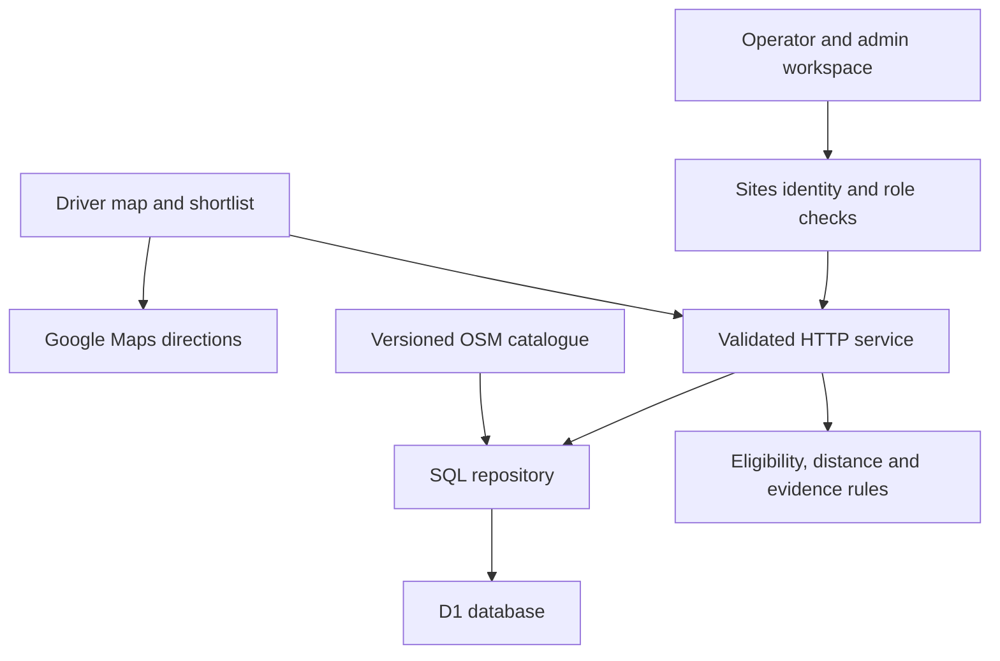

# Architecture and decisions

ParkMyCar is a bounded parking directory with an evidence and correction workflow. A facility record describes a location. An observation describes a time-limited statement about that location. These are separate records and separate UI concepts.



## Data model

| Table | Purpose and invariant |
|---|---|
| facilities | Stable ID, indexed coordinates, active/version columns and canonical JSON attributes. Private/permit/inactive facilities are excluded from public detail/search. |
| observations | Source, state, observation time and expiry; references a facility. Source class is operator or reviewed community. |
| members | Site-scoped identity, role and assigned facility IDs. Role checks run on every protected request. |
| settings | Catalogue seed version, one workspace owner, retention checkpoint. |
| reports | Recent driver report with unique deduplication key; moderation required. |
| listing_changes | Proposed operator edit and base version; approval uses compare-and-swap. |
| audit_events | Actor, action, entity, changed field names and timestamp. No trip coordinates or request bodies. |
| request_limits | Atomic fixed-window counters and shared provider spacing gate. |
| geocode_cache | Public place results, hashed query/provider key, retrieval/expiry times; no user association. |

The SQL migration is authoritative for database constraints. `db/schema.ts` generates future migrations through Drizzle; production queries use parameterized SQL behind `Store`. JSON fields support the small heterogeneous catalogue without pretending to be a fully normalized nationwide schema.

## Search and evidence flow

```mermaid
flowchart TD
  Input["Destination and filters"] --> Valid{ "Valid bounded request?" }
  Valid -->|No| Error["Helpful input error"]
  Valid -->|Yes| Bounds["Indexed coordinate bounds"]
  Bounds --> Eligible["Access, vehicle, hours and features"]
  Eligible --> Rank["Distance or known price ordering"]
  Rank --> Evidence["Current source evidence"]
  Evidence --> Results["Up to 30 map and list results"]
```

Haversine distance is straight-line proximity, not a road or pedestrian route. The radius is at most 2,500 metres. Searches inspect at most 200 catalogue records. Omitted feature data does not satisfy a requested EV/accessibility requirement; missing vehicle/hours/access information stays unknown unless the user excludes incomplete records. Results are sorted deterministically, with ID as a final tie-breaker. Missing prices sort after comparable known prices.

For each evidence class/source, the newest current observation supersedes its previous observation. Current conflicting states across sources yield `UNKNOWN`; consistent operator evidence remains operator-labelled. A new operator `UNKNOWN` clears that operator's earlier positive state. Expired/future/malformed observations cannot become current status. The browser re-evaluates expiry on a 30-second timer; search/detail retrieval rechecks against server time. It does not subscribe to live sensor events.

`PARKMYCAR_STATUS_TTL_MINUTES` configures newly created operator/community observation lifetimes, from 5 to 60 minutes, default 15. Changing it does not rewrite historical expiry. This is a pilot operating policy to calibrate with actual operators, not an empirically validated availability guarantee.

## ADR-001: D1 for this deployment

The provided technical/database documents propose PostgreSQL/PostGIS. The user allowed a stack decision. Managed D1 lets this version deploy with a real persistent database and no separately provisioned cloud credentials. At this five-location scale, a coordinate index plus exact Haversine filter is sufficient. The 200-record cap prevents implying city-scale spatial query performance.

Consequences: no `ST_DWithin`, no PostGIS geography, no nationwide routing matrix and no spatially precise entrance model are claimed. Before expansion, migrate facility coordinates to PostgreSQL `geography(Point,4326)` with GiST indexing, retain stable IDs, move source/evidence records as appropriate, and preserve API contracts. Verify distances against the existing domain cases; backfill sources and entrances; test cutover/rollback on a copy before switching production. Do not just remove the cap.

## ADR-002: Local data and navigation hand-off

Version 1.1 uses normal interactive OSM street tiles across India. A bundled, attributed CP GeoJSON layer remains available when street tiles are off. Parking catalogue search has no provider dependency. Destination/origin text lookup uses explicitly submitted Photon requests restricted to India; a separate service validates and normalizes GeoJSON, uses shared caching/rate controls and enforces a timeout. It never converts a general place into a parking listing. Google Maps links handle drive/walk routes; no in-app route times, detours or walk budgets are fabricated. See UPGRADE_1_1.md.

## ADR-003: Identity at the platform boundary

Sites supplies verified visitor identity headers. The adapter trusts them only when explicitly configured for that gateway. The application has a separate membership table; sign-in alone does not confer operator access. The initial owner claim is enabled only for owner-private setup and has a unique owner constraint. Service access to the private site does not create a user identity or admin role.

## Next integrations requiring real inputs

A contracted or self-hosted geocoder for scale, licensed in-app routing, surveyed entrances, operator-verified tariffs/hours, signed sensor ingest, and localization can extend the boundaries above. Sensor integration must define device identity, count meaning, clock skew, deduplication, facility mapping, expiry and revocation before accepting occupancy. An IoT button or random number would not constitute an integration.
